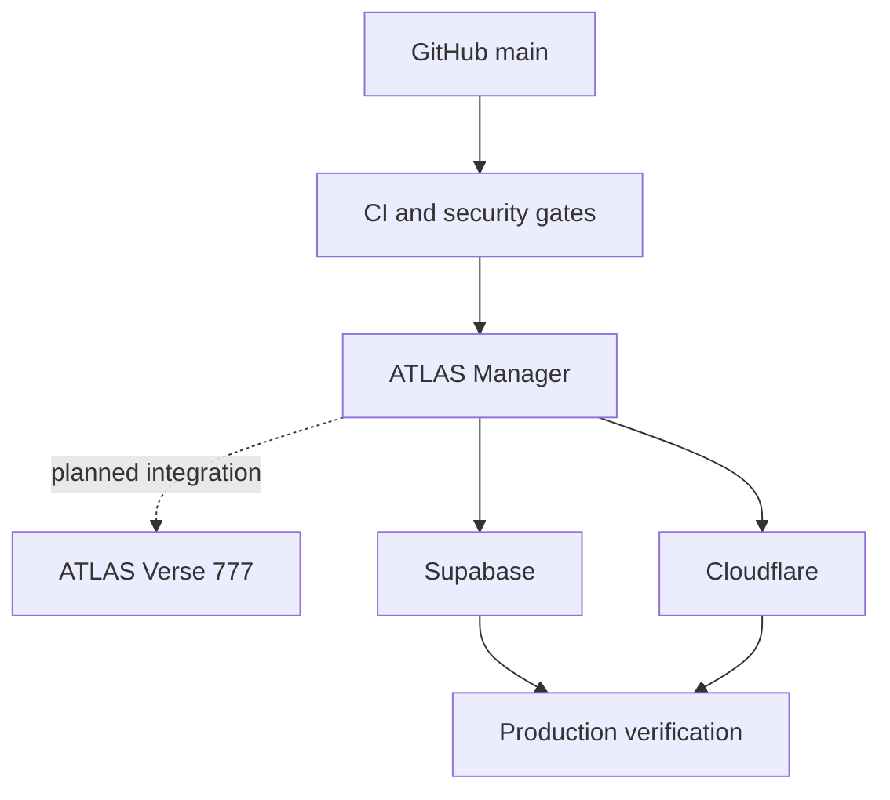

# ATLAS Enterprise Suite

**One enterprise platform. One canonical source. Evidence-driven delivery.**

ATLAS 777 REVIEW · Security by design · Sovereign release architecture

ATLAS Enterprise Suite is the shared enterprise platform for people, finance, operations, security, communication, intelligence, health, mobility, productivity, and connected services.

## Repository authority

- Canonical repository: `atlasenterprisesuite/atlasenterprisesuite`
- Production-stable branch: `main`
- A-Z integration branch: `release/atlas-a-z`
- Production URL: `https://www.atlasenterprisesuite.com`
- Governance: `docs/governance/ATLAS_CANONICAL_REPOSITORY.md`
- Infrastructure control plane: `docs/architecture/ATLAS_MANAGER_SPEC.md`
- Intelligence runtime migration: `docs/architecture/GPT_6_ASTRA_MIGRATION.md`
- Primary backend/control plane: Supabase `atlas-core` (`ggmanzcgtlrvqfoccgsh`)
- Primary public edge target: Cloudflare
- Primary OpenAI intelligence model: `gpt-6-astra` through the Responses API

The previously referenced `winderaranguren-gif/Atlas-enterprise-suite` repository is legacy/historical and is **not a blocker** for current ATLAS development. If access returns, unique work is reconciled through comparison and auditable integration; canonical history is not force-replaced.

## Platform architecture

| Layer | Responsibility | Status |
| --- | --- | --- |
| GitHub | Canonical source, pull requests and CI | Existing |
| ATLAS Manager | Shared infrastructure and release control plane | Existing control plane |
| ATLAS Verse 777 | First-party build, release and deployment orchestration | In development; [PR #1142](https://github.com/atlasenterprisesuite/atlasenterprisesuite/pull/1142) |
| Supabase | Backend, identity and data services | Canonical backend |
| Cloudflare | Public production edge | Canonical target |
| ATLAS 777 REVIEW | Evidence, release gates and runtime verification | Required policy |

The first-party release engine is the target architecture, not a claim of completed deployment capability. New development must use the canonical release path; legacy external deployment integrations must be retired through an audited migration without weakening required checks.

## Operating rule

ATLAS advances continuously through analysis, implementation, correction, testing, integration, deployment gates, and verification. Work stops only when a real human, legal, authorization, or technically irresolvable dependency makes further progress impossible. Independent work continues even when another dependency is blocked.

ATLAS Manager is the shared infrastructure control plane and deployment brain for the required GitHub → Supabase → Cloudflare → Production path. Release execution must converge through ATLAS Manager and the first-party release architecture rather than independent external deployment controllers. Cloudflare remains the canonical production edge.

## ATLAS 777 REVIEW — delivery contract

1. Diagnose and reuse existing modules, contracts and infrastructure before creating new components.
2. Plan, test, implement, review and validate each change through a protected pull request.
3. Enforce Zero Trust, least privilege, RBAC, tenant isolation, RLS where applicable, and auditable authorization.
4. Block releases on unresolved P0 findings; record P1 warnings and their disposition.
5. Merge only after required CI and review on the current candidate; preserve canonical history.
6. Verify the deployed commit SHA, critical routes and end-to-end behavior independently of build success.
7. Use approved resources only; do not incur unapproved costs or expose credentials.

Accessibility, responsive interfaces and reuse are acceptance criteria, not optional enhancements.

## Truthful production state

Code, validation, deployment, runtime, provider authorization, public-edge routing, and public production verification are tracked separately. Provider-dependent capabilities never claim `live`, `online`, `connected`, `ready`, or `verified` status without evidence.

A successful build/readiness workflow means the canonical source passed its software gates. It does **not** by itself mean that Cloudflare has deployed the artifact or that the public ATLAS domains are serving that build.

## Long-term repository layout

Because this repository name matches the GitHub account name, GitHub also treats it as the profile repository. The preferred future dedicated product repository is `atlasenterprisesuite/atlas-enterprise-suite`. That migration is non-blocking; this repository remains the canonical source until the new repository exists and migration is explicitly verified.
