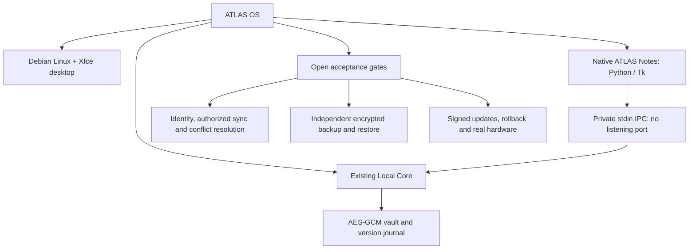

# ATLAS OS native VM foundation

Status: experimental source and image recipe, **P0 NO-GO**. No booted ISO, installed OS,
verified GUI, device synchronization or production release is implied by source tests.

## Architecture map



The first image uses Debian trixie amd64 and Xfce, with native ATLAS Notes in the
application menu. This is a distribution foundation, not a new kernel or a complete
custom ATLAS window manager. Existing enterprise modules remain in the canonical web
application and are not silently bundled or declared usable offline.

## Run the native app on a prepared Linux desktop

Requires Python 3 with Tk, Node.js 22+, and a graphical display:

```bash
python3 tools/atlas-os/notes.py
```

Unlock the local vault, edit, save, lock, and reopen. The passphrase travels to the
existing Node storage runtime through process stdin, not command arguments, environment,
files or a listening port. It stays in the GUI process while unlocked; locking clears
visible text and the application's passphrase reference, but is not guaranteed memory
zeroization. There is no cloud login or automatic enrollment. Linux session login and
local vault unlock are separate boundaries.

Notes use the existing vault's private directory, permissions, locking and atomic writes.
The fixed `local-device` journal namespace is a local prototype scope, not a tenant
identity or server authorization. The version journal preserves pending changes; it is
not an independent backup. It has the existing 64 KiB journal bound and 8 KiB per-value
limit; failed saves retain editor text. Concurrent application instances may encounter
vault_locked; unsaved windows are not merged automatically.

## Prepare and build an image

Prepare can run unprivileged and refuses to overwrite an existing destination:

```bash
python3 tools/atlas-os/image.py prepare /tmp/atlas-live
python3 tools/atlas-os/image.py check
```

For an ISO, use a separate disposable **Debian trixie amd64 builder VM** with root,
network access and these Debian packages installed: live-build, debootstrap, xorriso,
squashfs-tools, ca-certificates. Then:

```bash
python3 tools/atlas-os/image.py build /tmp/atlas-live
```

The script runs Debian's `lb config` / `lb build` and writes a SHA-256 checksum only if
the expected ISO actually exists. Build package versions are not snapshot-pinned yet:
this recipe is repeatable configuration, not proof of bit-for-bit reproducibility.
A source revision, dirty flag and SHA-256 hashes of the four allowed application files
are embedded in SOURCE.json. They are provenance metadata, not a signature.

No Debian disk installer is included. No partitioning, disk formatting, persistent
volume setup, cloud credentials or remote access service is created. Boot only as a
VM Live session: its storage is volatile and disappears on shutdown unless the VM has
separately configured persistence. Do not enter real credentials or valuable data.
Default Debian Live account behavior is not certified production login security.

## Verification

```bash
npm run test:atlas-os
npm run test:local-core
xvfb-run -a /usr/bin/python3 -m unittest discover -s tools/atlas-os/tests -p 'test_notes_gui.py'
```

The first two commands validate actual encrypted persistence across processes and
image staging. GUI tests are explicitly skipped without DISPLAY. The dedicated CI
workflow installs Xvfb/Tk and runs real widgets against the real temporary encrypted
vault; it uploads image **configuration**, not an ISO. A virtual display test does not
prove kernel boot or hardware support. No automatic ISO build is triggered by PRs.

Release acceptance remains open until: isolated ISO build, checksum verification,
VM kernel boot, desktop launch, notes round-trip, explicit persistence setup and
reboot test, backup/restore, authenticated two-device sync, conflict resolution,
revocation, independent review, signed updates and rollback evidence all exist.

## Official construction references

- https://live-team.pages.debian.net/live-manual/html/live-manual/managing-a-configuration.en.html
- https://live-team.pages.debian.net/live-manual/html/live-manual/customizing-contents.en.html
- https://live-team.pages.debian.net/live-manual/html/live-manual/customizing-run-time-behaviours.en.html

## Native navigation and local continuity loop

The native application now has working menus:

| Menu | Available functions |
| --- | --- |
| Archivo | New/open encrypted note, save, lock, exit; unsaved-change protection |
| Editar | Undo, redo, cut, copy, paste, select all through native text widgets |
| Ver | Interactive navigation graph, real journal counters, optional local polling, stop polling |
| Sistema | Host/runtime diagnostics and explicit sync/backup/persistence readiness explanations |
| Ayuda | Keyboard shortcuts and usage guide |

The graph connects the notes catalog, journal status, vault/storage explanation,
connection readiness, diagnostics and help. Every graph action also has a native
keyboard-focusable button. It does not represent implemented enterprise modules.
The encrypted catalog lists actual saved records; identifiers are encrypted on disk.
Existing single-note content remains under the `notes` record. Opening another record
asks before discarding unsaved changes; locking closes catalog windows and clears text.

The user's continuity/infinity direction is implemented here as an **optional local
status loop**, not unlimited autonomous execution: every 30 seconds while unlocked,
read actual encrypted journal counters. No network or automatic writes. One timer per
application; lock, close, stop or any read error cancels it. This does not synchronize
other devices, retry external jobs, resolve remote conflicts or prove persistence
across an operating-system restart.

Native GUI CI also exercises multiple notes, menu dialogs, the graph, a single owned
polling timer, cancellation on lock, catalog privacy, retention of text after failed
save and unsaved-change protection. Disk/ISO and multidevice acceptance gates remain
open. Broad repository tests previously blocked for unverified Supabase access are
not retried by these focused checks.
